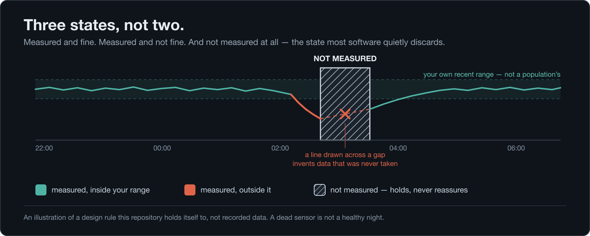
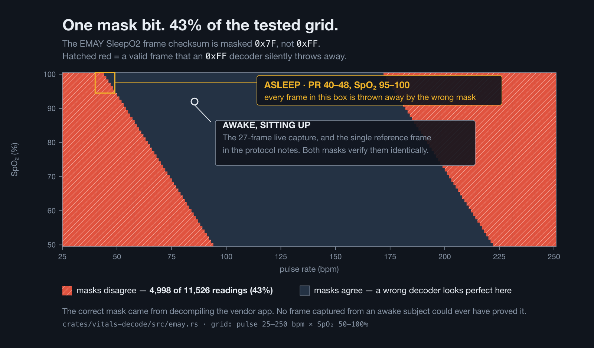

# AnxietyWatch2

**Open-source, local-first software for collecting and storing health data from Bluetooth sensors and CPAP devices.**

AnxietyWatch2 is an experimental health-monitoring project written in Rust. It records data from supported Bluetooth Low Energy (BLE) sensors, preserves where every sample came from, and includes a read-only integration for ResMed AirSense 11. It is a local-first successor to [AnxietyWatch](https://github.com/chenders/AnxietyWatch). The broader detector and alarm system remain planned work, not available features.

The software is not intrinsically tied to a particular board. Current collectors need Linux;
the reviewed deployment and live-acceptance evidence covers the existing ARM64 prototype only.
Other hosts need their own build and validation, not just a change of name.

Between a medication warning label about breathing and a clinical sleep study months away, American healthcare often leaves a gap: nobody is watching. This project explores how to close that gap at home, in the open, with the receipts. It is designed around the concept of continuous individual monitoring rather than population-scale data collection.

> [!WARNING]
> **Not a medical device.** This is an experimental open-source project. It has not been clinically validated and must not be relied on to diagnose, prevent, detect, or treat any medical condition. It is not a substitute for professional care, approved monitoring equipment, or emergency services. Physiological decoding and alarm logic may be incomplete, wrong, or absent.
>
> **The alarm does not exist yet.** If overnight breathing or medication safety concerns you, talk to a clinician and use validated monitoring—not this repository.

## Should I use this?

**Not as a clinically validated or emergency monitor.** The repository is experimental and the full CNS detector, supervised alarm path, and physical alarm are not complete. The ResMed AirSense 11 integration has a bounded Linux installation and read-only live-monitoring path, but it still must not be relied on for diagnosis, treatment, or emergency response.

Use it to **read, audit, develop, or run the explicitly bounded AirSense integration** on hardware you control. Keep validated monitoring and professional care in place. The most transferable materials are the [accepted architecture amendments](docs/specs/AMENDMENTS.md), the [AirSense integration guide](docs/integration/resmed-air11-user-guide.md), the [alarm-timing reassessment](docs/research/klaxon-alarm-timing-reassessment.md), and the project's safety invariants.

## Status: what is real, and what is still a design

**Under active development. Twelve of the fifteen Stage 0–3 tasks are complete.** The next software task is `bp-collector`. Follow the [task index](openspec/changes/pi5-vitals-core/tasks.md) for acceptance evidence and the [amendment index](docs/specs/AMENDMENTS.md) for current decisions.

### Built and tested
- Generated, strongly typed registries for eight vital types and five sources.
- Pure `no_std` decoders for IEEE-11073 SFLOAT, BLE heart-rate/RR, and EMAY SleepO2, with rigorous fuzz targets.
- PostgreSQL binary `COPY` encoding, an append-only spool with schema fingerprints, and restart-safe session identity.
- `vitalsd`, its Unix-socket CBOR protocol, health surface, and single-writer ingest path.
- `vitals-spool-drain`: single-drainer locking, private transactional `COPY` staging, live-schema fingerprint verification, disk-watermark degradation, and drain-liveness reporting.
- Sqitch schema definitions and encrypted pgBackRest backups with scheduled restore verification.

### Present, but pending deployment reconciliation
- The TimescaleDB hypertable, compression, one-minute aggregates, and raw-data retention are defined in migrations, but this chain is **not claimed as verified-deployed** while primary-key reconciliation remains open.

### Designed, not built
- `bp-collector` and the complete production collector fleet.
- `cns-engine`: quality gate, personal baseline, fusion, and hysteretic tier machine.
- `klaxond`: supervised alarm channels and the hardware dead-man switch.
- A clinically validated detector or emergency alarm. The Rust HTTP API, admin console, and AirSense read-only console path are present; a bedside panel exists as a display-only hardware-validation stopgap, but it is not a detector and cannot wake anyone.

## The rule everything else serves

**Unknown is not healthy.** There are always three states: measured-and-good, measured-and-bad, and *not measured*. Missing or invalid data contributes nothing. It never reassures, never escalates by itself, and is never joined by an invented line.



That rule reaches from bytes to bedside:
- **Reject; never clamp.** An out-of-range value is rejected with a named reason. A clamped value is indistinguishable from a real one downstream.
- **Absence is not zero.** Radio sentinels return no measurement, not a reassuring number.
- **Identity is not arrival time.** Several RR intervals can arrive in one notification, so samples are identified by `(source, type, session_id, seq)` rather than host timing.
- **Gaps remain gaps.** Physiological series are never interpolated or carried forward.
- **A viewer is never a dependency.** The target alarm path behaves the same with every screen unplugged.

## Clickable Trust: A decoder bug that waits for sleep

The repository distrusts plausible success. As an example, the EMAY SleepO2 checksum uses `sum(payload) & 0x7F`, not `& 0xFF`. Across the decoder's documented grid (pulse 25–250 bpm and SpO₂ 50–100), the masks disagree for **4,998 of 11,526 combinations (43%)**. 



A decoder using `0xFF` accepts the reference frame and the 27-frame awake capture. It then silently rejects every frame in the illustrated sleeping region as the wearer's pulse falls into the 40s. The correct mask came from decompiling the vendor app; no awake capture could have proved it. 

This is why this project demands receipts. Its CI mutation-tests gates that once reported green without compiling Rust. Every radio decoder gets a [fuzz target](fuzz/fuzz_targets/fuzz_emay.rs). A backup is not trusted merely because it was written: the project schedules a restore into a scratch cluster and checks the result.

## The Signal Path

The labels below are part of the diagram: the honesty boundary is implementation state, not visual polish.

```text
Polar H10 · EMAY SleepO2 · A&D BP cuff       CPAP · Oura · HealthKit
                │                                  planned imports
                ▼
collectors → pure decoders                  bp-collector and fleet: not built
                ▼
vitalsd → append-only COPY-binary spool     built
                ▼
vitals-spool-drain → PostgreSQL 16          drainer built; DB deployment reconciliation open
                ▼
cns-engine                                  designed, not built
quality gate → personal baseline → max-not-average fusion
→ clear · can't assess · watch · confirm · klaxon
                ▼
klaxond                                     designed, not built
GPIO piezo · bed shaker · speaker · Zigbee · push · haptic · hardware dead-man

viewers: bedside panel · web dashboard · admin console · phone
         never dependencies in the target alert path
```

The target radio-packet-to-tier-evaluation latency is p99 under two seconds. The alert path is native services under systemd: no network and no container between a sample and an alarm output.

## Install, run, and use the AirSense 11 integration

This is the currently documented operational path. It is **read-only**: it collects the authenticated live stream and stores observations through the existing `vitalsd`/PostgreSQL pipeline. It does not control therapy, pair implicitly, modify Bluetooth adapters, or replace medical monitoring. Follow the complete [AirSense operator guide](docs/integration/resmed-air11-user-guide.md) before using a real device.

### 1. Prepare the host

The existing reviewed deployment path targets ARM64 (`aarch64`) Linux. These steps describe
that prototype path, not a validated installer for arbitrary Linux computers. It needs:

- Rust `1.97.1` and the pinned target in [`rust-toolchain.toml`](rust-toolchain.toml);
- BlueZ, systemd, a working `vitalsd` Unix socket, and the existing spool/drain services;
- PostgreSQL 16 with the project's TimescaleDB schema deployed; and
- an operator-approved AirSense credential source and a device in app mode when discovery is required.

The repository does not provide a one-command production installer. Configure the required services through the reviewed prototype deployment procedure first; validating another host is separate work. Keep the AirSense unit disabled until the bounded acceptance run is authorized.

### 2. Build and verify

From a checkout on the Linux host (or from a compatible build environment):

```sh
rustup show active-toolchain
cargo build --release
cargo test --workspace
cargo clippy --workspace --all-targets --all-features -- -D warnings
```

Build the AirSense executables explicitly when only that integration is being staged:

```sh
cargo build --release -p vitals-collectors \
  --bin resmed-air11-collector --bin resmed-air11-onboard
```

Generated registry files must remain current:

```sh
python3 vitals/tools/gen_registry.py --check
```

### 3. Install the AirSense components

The allowlisted installer copies only the collector, onboarding utility, or fixed systemd unit. It uses a temporary remote directory and installs root-owned files at fixed destinations. The commands below retain their existing filenames and variable names for compatibility; they are not a hardware requirement. [Host-neutral naming](openspec/changes/host-neutral-naming/proposal.md) tracks the deferred renames. Run the installer from the repository after building for the target host's architecture:

```sh
PI_HOST=vitals@<host> PI_PATH=/path/to/checkout \
  scripts/install-air11-pi-artifact.sh collector
PI_HOST=vitals@<host> PI_PATH=/path/to/checkout \
  scripts/install-air11-pi-artifact.sh onboard
PI_HOST=vitals@<host> PI_PATH=/path/to/checkout \
  scripts/install-air11-pi-artifact.sh unit
```

Install and verify the AirSense Sqitch change with the deployment's approved database target; do not put a database password in a copied command:

```sh
sqitch deploy
sqitch verify
```

Install `deploy/vitals-console.service` and, only if fixed lifecycle actions are required, provision a separate owner-readable console-admin token and the narrowly scoped polkit rule. Never reuse the AirSense master key as the console-admin token.

### 4. Provision credentials and discover the target

The `vitals` service account must own a private credential file at:

```text
/var/lib/vitals/.air11/air11-credentials.json
```

It must be a regular owner-readable file with no group/other permissions, normally mode `0600`. Keep the client id, explicit Linux target address, and 32-byte master pair key out of shell arguments, logs, the browser, and Git. The admin console exposes readiness facts only.

If the target address is already known, continue to the readiness check. If bounded discovery or first pairing is explicitly authorized, run the installed utility interactively:

```sh
sudo -u vitals -H -- resmed-air11-onboard discover --adapter hci0 --duration 30 \
  --credentials /var/lib/vitals/.air11/air11-credentials.json
# or, for an explicitly authorized first-pair flow:
sudo -u vitals -H -- resmed-air11-onboard pair --adapter hci0 --duration 30 \
  --credentials /var/lib/vitals/.air11/air11-credentials.json
```

These are finite onboarding operations. They do not start collection or change unrelated Bluetooth configuration.

### 5. Start and use the console

Enable the console according to the host deployment procedure, then open it only from the private LAN:

```text
http://<host-private-address>:8480/console/?screen=air11&dir=a
```

The AirSense page has three presentation directions (`dir=a`, `dir=b`, and `dir=c`) over one backend view-model. The read-only kiosk is:

```text
http://<host-private-address>:8480/console/air11-kiosk.html
```

In the admin page:

1. Confirm credential readiness and database/configuration state.
2. Provision the separate console-admin capability if lifecycle controls are needed.
3. Choose **Opt in** and enter the displayed confirmation phrase.
4. Choose **Start collector** and enter its displayed confirmation phrase.
5. Require `active/running`, `STREAMING`, and `MEASURED`; a connected device alone is not success.

The page distinguishes measured, bad, unavailable, stale, and unknown states. Missing physiology is never converted to zero. Use the fixed Stop, Restart, and Opt out actions for lifecycle changes; opt-out is performed only after stopping the collector.

For authorized host diagnosis:

```sh
journalctl -u vitals-air11.service --no-pager -n 80
```

Treat an unavailable journal, database, credential, or measurement as a named blocker—not as an empty healthy result.

### 6. Run bounded live acceptance

Only on the existing validated prototype host, after operator authorization:

```sh
scripts/air11-pi-acceptance.sh --duration 60 --require-postgres --require-h10
```

The duration must be 20–3600 seconds and the script requires an interactive, duration-specific confirmation. It starts or restarts only the already-installed AirSense unit, checks credential shape without printing secrets, verifies measured/null evidence and database rows, exercises a reconnect, and stops a unit that it started. A nonzero exit status is failed acceptance. The script never pairs, scans indefinitely, enables a unit, edits `/boot/firmware`, changes routes, or sends a therapy-control RPC.

### Development and diagnostics

Useful local checks are:

```sh
python3 scripts/check-air11-public.py --self-test
python3 scripts/check-air11-admin-sql.py --self-test
python3 scripts/check-console-assets.py --self-test
cargo fmt --all -- --check
cargo test --workspace
```

Keep raw credentials, BLE journals, EDF files, and unredacted logs outside Git. Read [AMENDMENTS.md](docs/specs/AMENDMENTS.md) before changing storage, identity, time, units, or safety behavior.

An accepted optional mobility experiment allows a supported BLE sensor to reach an iPhone, then cross
private Wi-Fi to a local monitoring host; the host's status is mirrored back through the iPhone to the
existing BLE nRF52840 NeoPixel bracelet. This is an ambient convenience display—not an emergency
detector—and the planned detector and local alarm are designed to remain independent if iOS suspends
the relay. Wi-Fi bracelet hardware is deferred.
See [Amendment 17](docs/specs/2026-09-22-amendment-17-iphone-ble-mobility-relay.md).

## Engineering Invariants

- **Storage has a spool:** Collectors do not write the database directly. They send samples to the single-writer `vitalsd`, which appends rows already encoded in PostgreSQL binary `COPY` format. `vitals-spool-drain` copies them transactionally.
- **Safety-path hardware:** Every alarm output must be provably OFF from power-on until `klaxond` takes control. GPIO floats before configuration, so a 10 kΩ gate-to-source pulldown is mandatory on every MOSFET.
- **OOM adjustments:** `OOMScoreAdjust=-1000` on the daemon and collectors. Without this, the kernel kills the alarm to save the database.

## Repository map

| Path | Purpose |
|---|---|
| [`crates/`](crates/) | Registry, decoders, spool core, socket protocol, `vitalsd`, drainer, capture tools |
| [`vitals/`](vitals/) | Registry source plus generated Rust, SQL, and JSON |
| [`db/`](db/) | Sqitch deploy, revert, and verify migrations |
| [`fuzz/`](fuzz/) | `cargo-fuzz` targets for hostile radio input |
| [`deploy/`](deploy/) | Native service definitions, restore verification, stopgap panel |
| [`docs/specs/`](docs/specs/) | Accepted architecture amendments |
| [`docs/design/`](docs/design/) | Theory of operation and interface research |
| [`docs/research/`](docs/research/) | Baseline, alarm timing, and protocol evidence |
| [`openspec/changes/pi5-vitals-core/`](openspec/changes/pi5-vitals-core/) | Current task contracts and exact verification commands |

## Documentation

- [Theory of operation](docs/design/theory-of-operation/theory-of-operation.html) — the completed design, end to end.
- [Current task contracts](openspec/changes/pi5-vitals-core/tasks.md) — acceptance is each command's exit code.
- [Accepted amendments](docs/specs/AMENDMENTS.md) — current decisions; these override older prose.
- [Stage 7 Apple-client specification](docs/design/SPEC-ios-client.md) — the thin iPhone/watchOS
  HealthKit proxy, subjective-input client, local-host viewer, and its
  [execution plan](openspec/changes/ios-client-stage7/tasks.md).
- [Contributor and agent rules](AGENTS.md) — safety invariants, scope, tests, and workflow.

## Licence

[MIT](LICENSE)
